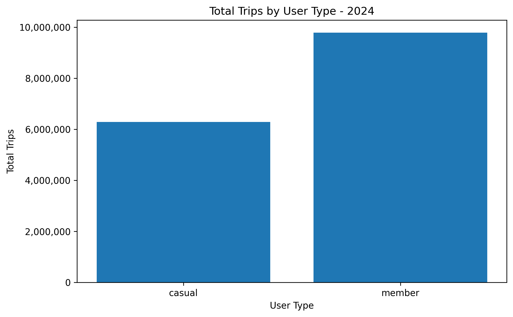
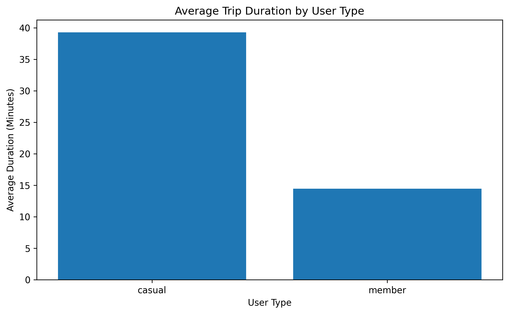
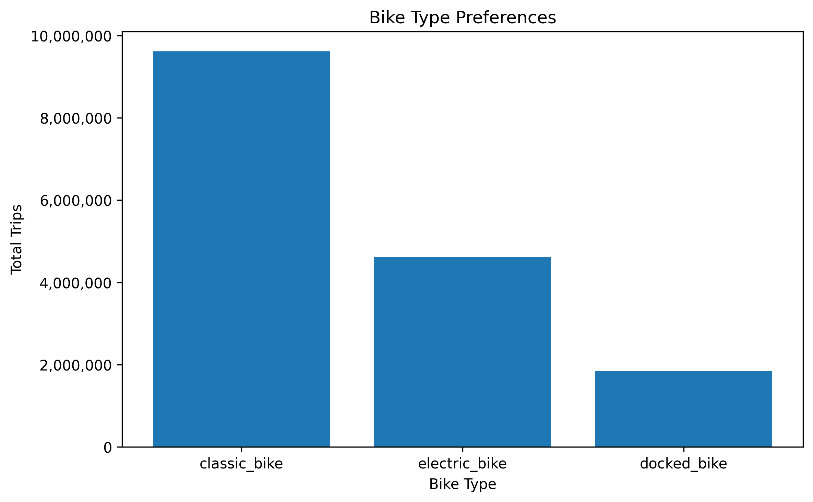
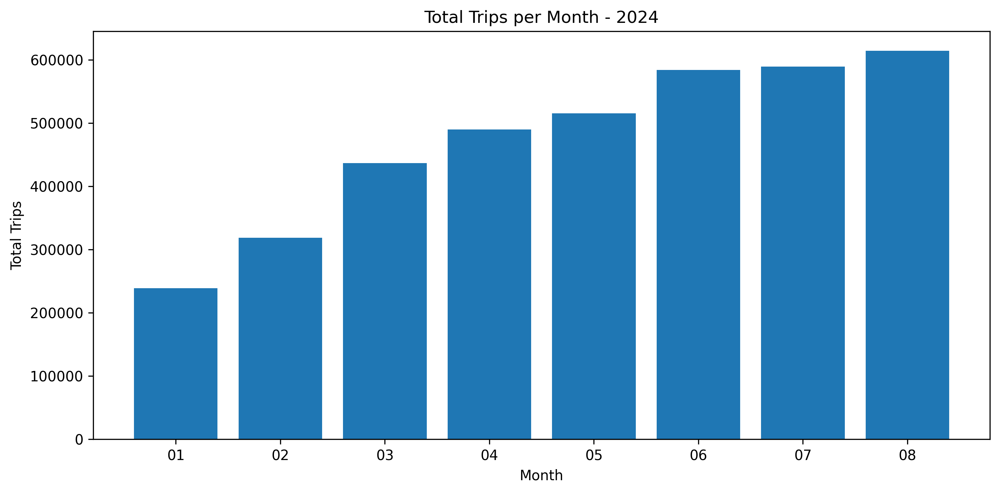
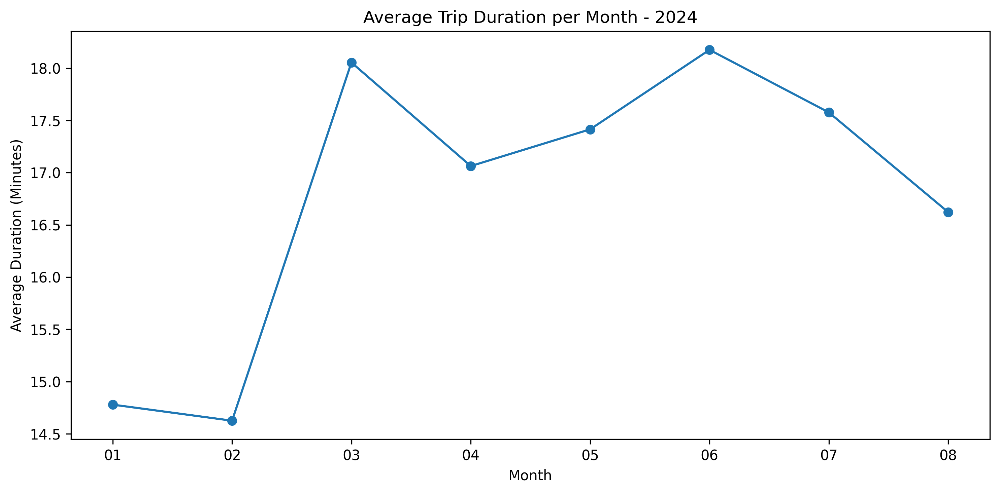
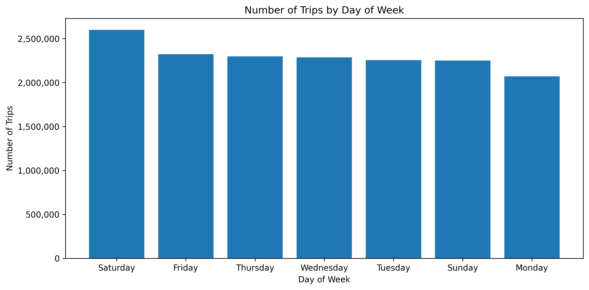
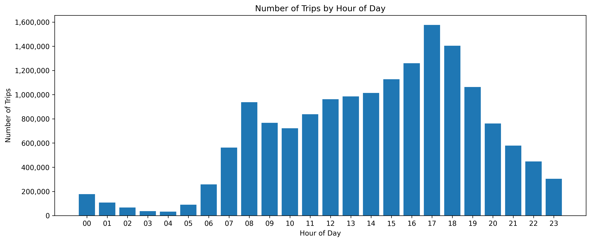

<div align="center">

# 🚲 Capital Bikeshare — Data Analysis Project

### Turning Bike-Share Trip Data into Actionable Business Insights

**A collaborative data analysis project using SQL, SQLite, Python, and Pandas to explore ridership behavior, demand patterns, station activity, trip duration, and weather-related trends.**

</div>

---

## 📌 Project Overview

This project analyzes Capital Bikeshare trip data to understand how people use a bike-sharing service and identify opportunities to improve operations and customer experience.

Using SQL queries on a SQLite database, the analysis explores more than **16 million trips recorded between May 2020 and August 2024**, with a focused monthly trend analysis for January–August 2024.

The goal is to transform raw trip records into meaningful findings that can support better bike distribution, fleet planning, customer engagement, and future demand forecasting.

> **Project type:** Collaborative Data Analysis Project  
> **Primary focus:** SQL-based exploratory data analysis (EDA) and business insights

## 🎯 Business Questions

The analysis investigates questions such as:

- **Demand patterns:** Which days of the week and hours of the day have the highest trip volumes?
- **Rider behavior:** How do registered members and casual riders differ in trip frequency and average duration?
- **Bike preferences:** Which bike types are used most frequently?
- **Station performance:** Which stations and routes record the most activity?
- **Trip characteristics:** How are trips distributed by duration, and how common are round trips?
- **Weather patterns:** How does average daily ridership vary across sunny, cloudy, windy, and rainy days?
- **Data quality:** Are there invalid timestamps, negative durations, or unusually long trips that need attention?

## 🛠️ Tools & Technologies

| Tool | Purpose |
|---|---|
| **SQL** | Querying, aggregating, filtering, and joining trip data |
| **SQLite** | Creating and managing the relational database |
| **Python** | Data loading and analysis workflow |
| **Pandas** | Importing CSV files, loading tables, and working with query results |
| **Matplotlib** | Visualizing selected results |
| **Google Colab** | Documenting the analysis and presenting findings |

## 🗂️ Dataset & Database Setup

The project uses the [Capital Bikeshare Dataset on Kaggle](https://www.kaggle.com/datasets/taweilo/capital-bikeshare-dataset-202005202408).

The data is organized into four tables:

- `daily_rent_detail` — individual trip records, timestamps, station IDs, bike type, and rider category.
- `station_list` — station identifiers and station names.
- `weather` — daily weather observations, including weather conditions and precipitation.
- `usage_frequency` — additional usage-related data supplied with the dataset.

A SQLite database was created to support SQL-based exploration and joins between trip, station, and weather data. To reduce memory usage while importing the large trip-detail CSV, the data was loaded in chunks of **50,000 rows**.

## 🔎 Analysis Workflow

1. **Data ingestion:** Downloaded the source dataset and loaded the CSV files into SQLite.
2. **Database exploration:** Inspected the available tables, schemas, sample records, and row counts.
3. **Data quality checks:** Investigated timestamp validity, trip duration, and unusually long trips.
4. **Exploratory analysis:** Used SQL aggregations, filters, grouping, and joins to answer the business questions.
5. **Visualization:** Created charts to communicate selected patterns in rider behavior and demand.
6. **Business interpretation:** Summarized the findings and translated them into operational recommendations.

## 📊 Key Findings

The notebook reports the following findings:

- **Member vs. casual behavior:** Registered members accounted for approximately **60.8% of trips**. Casual riders had a longer average trip duration than members (**39.3 minutes vs. 14.5 minutes**).
- **Bike type preference:** Classic bikes were the most frequently used type, with approximately **9.61 million trips**.
- **Peak demand:** **5:00 PM** was the busiest trip-start hour, while **Saturday** had the highest trip volume by day of the week.
- **Trip duration:** Short trips (under 10 minutes) formed the largest duration category, with approximately **7.07 million trips**.
- **Station and route activity:** Trip activity was concentrated around particular stations and routes, creating opportunities to improve bike redistribution and capacity planning.
- **Weather patterns:** Average trip volumes differed across recorded weather conditions, suggesting weather could be explored as one factor in future demand forecasting.

*These findings describe patterns in the analyzed dataset and should not be interpreted as proof that any single factor causes changes in ridership.*

## 📈 Visualizations

Add your exported graph images to a folder named `images` in the GitHub repository. The image paths below are placeholders—replace each filename with the exact name of the image you upload.

### 1. Trips by Rider Type

Compare total trip volume for registered members and casual riders.



### 2. Average Trip Duration by Rider Type

Compare how long members and casual riders typically ride.



### 3. Trips by Bike Type

Explore the distribution of trips across bike types.



### 4. Monthly Trip Trends — 2024

Examine how trip volume and average trip duration changed month by month.

<p align="center">
  
  
</p>

<p align="center">
  <em>Monthly trip volume</em> &nbsp; | &nbsp; <em>Monthly average trip duration</em>
</p>

### 5. Trips by Day of the Week

Identify differences in ridership across weekdays and weekends.



### 6. Trips by Hour of the Day

Highlight peak trip-start hours and potential periods of high demand.



## 💡 Business Recommendations

Based on the observed patterns, the analysis suggests several opportunities:

1. **Optimize bike redistribution:** Prioritize stations with high departure activity and plan around peak demand periods.
2. **Improve membership conversion and retention:** Explore targeted membership offers for casual riders, whose average trips are longer.
3. **Plan fleet allocation:** Use demand patterns by bike type, station, and time to support operational decisions.
4. **Explore demand forecasting:** Combine historical trip volume, time-based patterns, and weather data to investigate future demand prediction.
5. **Strengthen data quality controls:** Validate timestamps and trip durations, and investigate unusual records before using them in operational reporting.

These recommendations are starting points for further investigation. Fleet availability, operating costs, and additional operational data would help assess their feasibility and expected impact.

## 📁 Repository Structure

A suggested repository structure:

```text
Capital-Bikeshare-Data-Analysis/
│
├── Capital_Bikeshare.ipynb
├── README.md
├── images/
│   ├── trips-by-rider-type.png
│   ├── average-trip-duration-by-rider-type.png
│   ├── trips-by-bike-type.png
│   ├── monthly-trip-volume-2024.png
    ├── monthly-average-duration-2024.png
│   ├── trips-by-day-of-week.png
│   └── trips-by-hour-of-day.png

```

## 🚀 How to Explore the Project

1. Clone or download this repository.
2. Install the required Python libraries.
3. Download the dataset from the [Kaggle source](https://www.kaggle.com/datasets/taweilo/capital-bikeshare-dataset-202005202408).
4. Open `Capital_Bikeshare.ipynb` in Google Colab.
5. Run the notebook cells in order, updating the dataset path if necessary.

### Requirements

```bash
pip install pandas matplotlib kagglehub
```

The notebook uses SQLite through Python's built-in `sqlite3` module. Depending on your environment, you may need to configure Kaggle access to download the dataset through `kagglehub`.

## 👥 Collaboration

This was completed as a **team project**. The notebook documents a collaborative analysis workflow, combining SQL-based exploration with data interpretation and business recommendations.

## 👩‍💻 About the Project

This project demonstrates practical use of SQL and SQLite to explore a large dataset, answer business-focused questions, and communicate findings through visualizations and recommendations.

---

<div align="center">

**Thanks for visiting!**

*Driven by curiosity. Powered by data. Focused on impact.*

</div>
